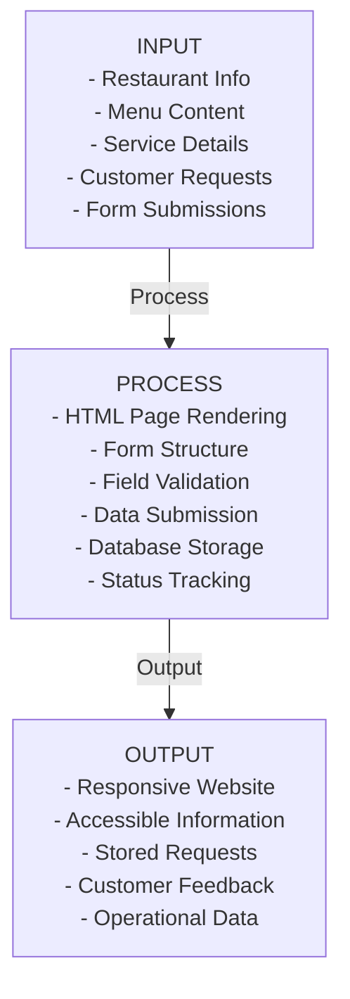

# Valois Grillhouse System Documentation

## Section 1: Background of the Study

**Problem:** Before the proposed system was implemented, restaurant information was distributed across multiple static pages, while customer requests (reservations, catering, curbside orders, and contact inquiries) could not be stored or processed centrally.
**Context:** A centralized web-based request system is important because it gives customers a consistent way to submit information and gives the restaurant organized records for follow-up and operational management.

## Section 2: Statement of the Problem

**General Problem:**
The Valois Grillhouse website currently presents information but lacks the ability to process and store customer service requests, limiting operational efficiency and customer interaction capability.

**Specific Problems:**
1. Customer reservation requests are received but cannot be stored or tracked
2. Catering inquiries cannot be recorded or followed up on
3. Curbside pickup orders cannot be documented
4. Contact inquiries cannot be persisted for response management
5. No centralized system for managing customer interactions

## Section 3: Objectives of the Study

**General Objective:**
To develop a functional web-based information and request management system for Valois Grillhouse.

**Specific Objectives:**
1. Implement persistent storage for all customer service requests
2. Create a structured database to organize customer interaction data
3. Develop backend API to process form submissions
4. Integrate forms with functional submission handlers
5. Provide validation for data quality and accuracy
6. Ensure user feedback on successful/failed submissions

## Section 4: Proposed System Features

| Feature | Status | Description |
|---------|--------|-------------|
| Contact Form Submission | Implemented | Customers can submit contact inquiries; stored in database |
| Reservation Request Form | Implemented | Customers can request reservations; stored in database |
| Catering Inquiry Form | Implemented | Customers can request catering services; stored in database |
| Curbside Pickup Form | Implemented | Customers can place curbside pickup orders; stored in database |
| Form Validation | Implemented | Client-side and server-side validation of required fields |
| Success Feedback | Implemented | Clear messages to users upon successful submission |
| Error Feedback | Implemented | Clear error messages for invalid input or failed submission |
| Responsive Design | Implemented | Website remains responsive across all devices |
| Data Persistence | Implemented | All submissions stored in SQLite database |
| Information Access | Future Enhancement | Potential for management dashboard to review stored requests |
| Automated Notifications | Future Enhancement | Email confirmations to customers and staff |

## Section 5: Conceptual Framework (IPO Model)

**Explanation:** The inputs are restaurant information, service details, and customer form submissions. The system processes these inputs through HTML form presentation, client-side and server-side validation, REST API submission, and SQLite database storage. The outputs are an accessible responsive website, stored customer requests, and success or error feedback that supports restaurant follow-up.

## Section 6: Possible Research Variables

| Variable | Type | Possible Measurement or Evaluation |
|----------|------|------------------------------------|
| User interface clarity (form labeling and instructions) | Independent | User ratings from a usability questionnaire and observed completion errors |
| Form field organization and layout | Independent | User ratings, completion time, and form abandonment rate |
| Validation feedback quality | Independent | User ratings of error-message clarity and number of repeated invalid submissions |
| Website navigation structure | Independent | Task-completion rate and time required to find a form or information page |
| User satisfaction with form submission | Dependent | Likert-scale questionnaire score after completing a form |
| Accuracy of submitted data | Dependent | Percentage of submissions accepted without missing or invalid required values |
| Form completion rate | Dependent | Completed submissions divided by form starts, expressed as a percentage |
| User perception of ease of use | Dependent | Average usability rating from participants |

## Section 7: Possible Research Questions

1. How effectively does the system capture and store customer service requests?
2. Does form validation improve data quality and reduce submission errors?
3. Is the user feedback (success/error messages) clear and helpful to customers?
4. How well does the responsive design work across different device types?
5. What is the user satisfaction level with the reservation/catering/curbside ordering process?
6. Does the centralized storage of customer requests improve business operations?

## Section 8: Recommended Technology Stack

| Component | Technology | Version | Rationale |
|-----------|-----------|---------|-----------|
| Frontend | HTML5 | HTML5 | Semantic markup, native form support |
| Styling | CSS3 | CSS3 | Responsive design with Grid/Flexbox |
| Client-Side Logic | Vanilla JavaScript | ES6+ | No framework overhead for form handling |
| Backend | Python | 3.8+ | Lightweight, readable, suitable for student projects |
| Web Framework | Flask | 2.3.3 | Minimal, flexible, easy to understand |
| Database | SQLite3 | 3.x | Local, zero-config, appropriate for single-server setup |
| Hosting/Deployment | Render or comparable Python hosting platform | To be selected | Provides a deployment target for the Flask API; local development remains supported |
| API Communication | RESTful API (JSON) | — | Standard web service pattern |
| Package Manager | pip | — | Python standard for dependency management |
| Version Control | Git | — | Repository already initialized |
| IDE/Editor | VS Code | — | Recommended for team consistency |

## Section 9: Suggested Database Tables

| Table Name | Purpose | Primary Key | Fields |
|-----------|---------|------------|--------|
| **contact_inquiries** | Store customer contact messages | `inquiry_id` (INTEGER, PK) | `name` TEXT, `email` TEXT, `topic` TEXT, `message` TEXT, `status` TEXT, `created_at` TIMESTAMP |
| **reservations** | Store reservation requests | `reservation_id` (INTEGER, PK) | `customer_name` TEXT, `email` TEXT, `phone` TEXT, `reservation_date` TEXT, `reservation_time` TEXT, `guest_count` INTEGER, `occasion` TEXT, `status` TEXT, `created_at` TIMESTAMP |
| **catering_requests** | Store catering event inquiries | `catering_id` (INTEGER, PK) | `customer_name` TEXT, `email` TEXT, `event_date` TEXT, `guest_count` INTEGER, `event_type` TEXT, `request_details` TEXT, `status` TEXT, `created_at` TIMESTAMP |
| **curbside_orders** | Store curbside pickup orders | `order_id` (INTEGER, PK) | `customer_name` TEXT, `phone` TEXT, `pickup_time` TEXT, `order_details` TEXT, `status` TEXT, `created_at` TIMESTAMP |
| **menu_items** | Menu structure (future use) | `menu_item_id` (INTEGER, PK) | `name` TEXT, `category` TEXT, `description` TEXT, `price` DECIMAL, `image_path` TEXT, `is_available` BOOLEAN, `created_at` TIMESTAMP |

**Key relationship note:** The current schema uses independent request tables and does not define foreign keys. No foreign key is required for the present form-submission workflow; future customer accounts or staff-management features could introduce related user or staff tables and foreign-key relationships.

## Alignment Matrix: Problems → Objectives → Questions → Features → Database

| Problem | Objective | Research Question | System Feature | Data Table |
|---------|-----------|-------------------|-----------------|-----------|
| Customer requests cannot be stored | Implement persistent storage | How effectively does the system capture requests? | Contact/Reservation/Catering/Curbside forms | contact_inquiries, reservations, catering_requests, curbside_orders |
| No request tracking capability | Create centralized request management | Does centralized storage improve operations? | Database with request records | All request tables |
| Information scattered across pages | Provide accessible information | Does responsive design work across devices? | Responsive HTML/CSS website | N/A |
| No data quality assurance | Improve data accuracy | Does validation reduce submission errors? | Form validation (client + server) | All request tables (status field) |
| No user feedback on submissions | Provide operational clarity | Is the feedback clear and helpful? | Success/error messages to users | N/A |
