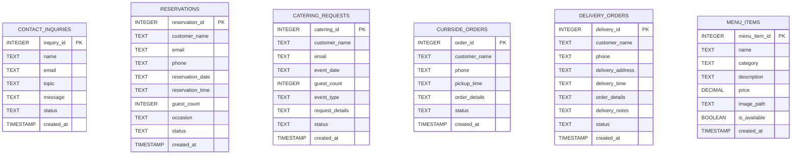

# Valois Grillhouse: Web-Based Restaurant Information, Interactive Menu, and Customer Service Management System
**Full System & Defense Documentation**

---

## Table of Contents
1. [Background of the Study](#1-background-of-the-study)
2. [Statement of the Problem](#2-statement-of-the-problem)
3. [Objectives of the Study](#3-objectives-of-the-study)
4. [Scope and Limitations](#4-scope-and-limitations)
5. [Proposed and Implemented System Features](#5-proposed-and-implemented-system-features)
6. [Conceptual Framework (IPO Model)](#6-conceptual-framework-ipo-model)
7. [Research Variables](#7-research-variables)
8. [Research Questions](#8-research-questions)
9. [System Architecture & Technology Stack](#9-system-architecture--technology-stack)
10. [Database Design & Schema (6 Tables)](#10-database-design--schema-6-tables)
11. [REST API Specification](#11-rest-api-specification)
12. [Frontend Modules & Professor Feedback Enhancements](#12-frontend-modules--professor-feedback-enhancements)
13. [Alignment Matrix](#13-alignment-matrix)
14. [Testing & Verification Summary](#14-testing--verification-summary)
15. [Defense Presentation Guide & Anticipated Panel Q&A](#15-defense-presentation-guide--anticipated-panel-qa)

---

## 1. Background of the Study

### 1.1 Current Situation
In the modern hospitality industry, a restaurant's digital presence serves as both its primary marketing storefront and its operational intake channel. Customers expect to browse a visual menu with accurate descriptions and pricing in their preferred currency, inspect dish details before ordering, book dining room reservations, inquire about event catering, and place take-home orders via either **curbside pickup** or **doorstep delivery**—all from desktop or mobile device browsers.

### 1.2 Existing Problems Prior to the System
Prior to the full-stack and professor-guided upgrades, the Valois Grillhouse website existed only as a static informational brochure with several critical limitations:
1. **Lack of Persistent Transaction Storage:** Customer submissions for reservations, catering, curbside pickup, and contact inquiries were not connected to a backend server or database.
2. **Absence of a Delivery Fulfillment Option:** Customers who wanted Valois Grillhouse meals at home were restricted to curbside pickup only, with no option to enter a delivery address or schedule courier delivery.
3. **Static, Non-Interactive Menu without Beverages:** The menu page displayed plain text rows without dish photography, detailed nutritional/ingredient breakdowns, beverage offerings, or dual-currency (`$ USD` / `₱ PHP`) support.
4. **Limited Mobile Browser Usability:** Navigation bars and layouts were difficult to operate on small smartphone viewports, and form handlers were hardcoded to `127.0.0.1`, preventing mobile devices on a local network from submitting forms.

### 1.3 Importance of the System
Developing the upgraded **Valois Grillhouse Web-Based Information and Customer Service Management System** bridges the gap between static brand presentation and functional restaurant operations. By combining an interactive, photo-driven menu (with clickable dish modals, signature drinks, and real-time USD/PHP price conversion) with a unified Curbside & Delivery ordering workflow and a Python Flask + SQLite backend, the system improves customer decision-making, expands order channels, and provides structured, persistent operational records.

---

## 2. Statement of the Problem

### 2.1 General Problem
How to design, develop, and implement a mobile-compatible, full-stack web-based restaurant information, interactive menu, and customer request management system for **Valois Grillhouse** that centralizes table reservations, catering inquiries, contact messages, curbside pickup orders, and home delivery orders into a persistent database.

### 2.2 Specific Problems
1. **Menu Presentation & Information Depth:** How to improve the menu page from a plain text list into an interactive, visual experience where clicking any dish or drink displays its photograph, full culinary description, ingredients, pairing notes, and dual-currency (`$ USD` and `₱ PHP`) pricing.
2. **Beverage Menu Completeness:** How to integrate a complete Drinks & Bar category (signature cocktails, wine, and zero-proof refreshers) with dedicated studio photography into both the frontend menu and backend database.
3. **Order Fulfillment Flexibility (Curbside vs. Delivery):** How to provide customers with a unified ordering interface that lets them seamlessly toggle between **Curbside Pickup** and **Home Delivery**, capturing required delivery addresses and landmarks when delivery is selected.
4. **Data Persistence & Validation:** How to validate and store customer submissions (Reservations, Catering, Curbside Pickup, Home Delivery, and Contact Inquiries) reliably in a relational database while preventing duplicate or incomplete submissions.
5. **Mobile Browser Compatibility:** How to ensure the website, interactive dish modal, navigation menu, and API form handlers operate smoothly across mobile smartphone browsers as well as desktop browsers.

---

## 3. Objectives of the Study

### 3.1 General Objective
To develop a responsive, mobile-compatible, full-stack restaurant website and customer service management system for **Valois Grillhouse** featuring an interactive visual menu with drinks and USD/PHP currency conversion, a combined Curbside Pickup and Home Delivery ordering workflow, and a Flask + SQLite backend.

### 3.2 Specific Objectives
1. **To redesign the Menu Page (`Our Menu.html`) into an interactive catalog** where clicking any of the 25 dishes or drinks opens a detailed modal popup displaying high-resolution dish photography, preparation notes, key ingredients, dietary badges, pairing recommendations, and a direct *"Order for Curbside / Delivery"* link.
2. **To expand the menu with a complete Drinks & Cocktails category** featuring seven beverages (*Old Fashioned, Red Wine Sangria, Classic Mojito, Cabernet Sauvignon, Berry Lemonade, Smoked Peach Iced Tea,* and *Citrus Cooler*) with custom studio imagery and database records.
3. **To implement a live Currency Conversion Toggle (`$ USD` ↔ `₱ PHP`)** across the menu, dish detail modal, and online ordering page, persisted via `localStorage`.
4. **To integrate a combined Curbside Pickup and Home Delivery ordering module (`Valois's Curbside.html`)** that dynamically switches form validation and API targets between `/api/curbside` and `/api/delivery`.
5. **To build and validate a RESTful Flask backend (`backend/app.py`) and SQLite database (`database/valois.db`)** with six structured tables (`contact_inquiries`, `reservations`, `catering_requests`, `curbside_orders`, `delivery_orders`, and `menu_items`).
6. **To ensure full mobile browser compatibility** through a responsive hamburger navigation drawer, touch-friendly controls, mobile-safe `16px` form inputs, bottom-sheet modals, and dynamic host resolution for LAN/Wi-Fi mobile testing.

---

## 4. Scope and Limitations

### 4.1 Scope
* **Public-Facing Multi-Page Web Application (8 Pages):** Home (`index.html`), Reservations (`Reservation.html`), Catering (`Catering.html`), Curbside & Delivery (`Valois's Curbside.html`), About (`About.html`), Interactive Menu (`Our Menu.html`), Gallery (`Gallery.html`), and Contact (`Contact.html`).
* **Interactive Menu & Currency System:** 25 total items across 5 categories (*Prime Steaks, Coastal & Seafood, From the Fire, Sides & Greens, Drinks & Bar*), category filter tabs, clickable detail modal, and instant `$ USD` / `₱ PHP` toggle.
* **Customer Request & Order Forms:** Five distinct operational workflows (Contact, Reservation, Catering, Curbside Pickup, and Home Delivery) with client-side and server-side validation.
* **Backend & Database:** Python Flask REST API (`GET /api/health`, `GET /api/menu`, `POST /api/contact`, `POST /api/reservations`, `POST /api/catering`, `POST /api/curbside`, `POST /api/delivery`) backed by SQLite3 (`database/valois.db`) and CLI inspection utilities (`init_db.py`, `view_db.py`, `test_endpoints.py`).

### 4.2 Limitations
* **Online Payment Processing:** The system records curbside and delivery orders for pay-on-pickup or cash/card-on-delivery; third-party payment gateways (e.g., Stripe, GCash, Maya) are outside the current academic scope.
* **Real-Time GPS Courier Tracking:** Delivery orders capture the customer's address, preferred delivery time, and landmark notes, but live map courier tracking is not included.
* **Admin Authentication Portal:** Database records are currently inspected via the CLI database viewer (`python view_db.py`) and REST endpoints rather than a password-protected web dashboard.

---

## 5. Proposed and Implemented System Features

| Feature Module | Status | Description |
|---|---|---|
| **Interactive Clickable Menu & Dish Modal** | Implemented | Clicking any dish or drink card opens a rich modal with full-size photo, long description, portion specs, ingredients, pairings, and one-click order handoff. |
| **Drinks & Bar Menu Category (7 Drinks)** | Implemented | Includes *Old Fashioned, Red Wine Sangria, Classic Mojito, Cabernet Sauvignon, Berry Lemonade, Smoked Peach Iced Tea,* and *Citrus Cooler* with dedicated studio photos. |
| **Dual-Currency Toggle (`$ USD` ↔ `₱ PHP`)** | Implemented | Toggles all menu card prices, modal prices, delivery fees, and quick-add order pills between US Dollars and Philippine Pesos, saved in `localStorage`. |
| **Combined Curbside & Delivery Ordering** | Implemented | Interactive mode selector on `Valois's Curbside.html` lets customers switch between Curbside Pickup (`/api/curbside`) and Home Delivery (`/api/delivery`) with dynamic address fields. |
| **Quick-Add Order Builder & Menu Handoff** | Implemented | Customers can click quick-add dish/drink pills or click *"Order for Curbside / Delivery"* inside any menu modal to pre-fill their order form automatically. |
| **Table Reservation System** | Implemented | Captures date, time, party size, occasion, and contact info into the `reservations` table via `POST /api/reservations`. |
| **Catering Inquiry System** | Implemented | Captures event date, guest count, and event notes into the `catering_requests` table via `POST /api/catering`. |
| **Contact Inquiry System** | Implemented | Captures customer questions and feedback by topic into the `contact_inquiries` table via `POST /api/contact`. |
| **Mobile-First Browser Compatibility** | Implemented | Hamburger navigation toggle (`<= 820px`), touch-scrollable category tabs, mobile bottom-sheet modal, and LAN-compatible API endpoint resolution. |
| **Dual-Layer Validation & Duplicate Prevention** | Implemented | Both `FormHandler` (JavaScript) and `backend/app.py` (Flask) validate required fields, email formats, and positive integer counts while disabling buttons during submission. |

---

## 6. Conceptual Framework (IPO Model)

```mermaid
flowchart LR
    subgraph INPUT["INPUT"]
      I1["Customer Browsing Actions<br/>(Category Filter, Currency Toggle, Dish Click)"]
      I2["Service Submissions<br/>(Reservations, Catering, Contact)"]
      I3["Order Fulfillment Details<br/>(Curbside Pickup vs. Home Delivery + Address)"]
      I4["25 Menu Items & Photos<br/>(18 Dishes + 7 Drinks)"]
    end

    subgraph PROCESS["PROCESS"]
      P1["Interactive Frontend Rendering<br/>(Dish Detail Modal, USD/PHP Conversion, Dynamic Form Fields)"]
      P2["Client-Side Validation & Handoff<br/>(FormHandler JS, Duplicate Lock, Dynamic Host Resolution)"]
      P3["Flask REST API Processing<br/>(Server-Side Validation, JSON Error/Success Standardization)"]
      P4["SQLite Database Persistence<br/>(INSERT & SELECT across 6 Relational Tables)"]
    end

    subgraph OUTPUT["OUTPUT"]
      O1["Visual Dish/Drink Modal<br/>with Dual-Currency Pricing"]
      O2["Real-Time User Confirmation<br/>& Validation Feedback"]
      O3["Persisted Database Records<br/>(Curbside, Delivery, Reservations, Catering, Inquiries)"]
      O4["CLI & API Operational Reports<br/>(view_db.py & /api/menu)"]
    end

    INPUT --> PROCESS --> OUTPUT
```

**Explanation of the IPO Model:**
* **Input:** Encompasses user interactions on the menu (filtering categories, toggling between `$ USD` and `₱ PHP`, clicking dish cards) and customer form inputs across Reservations, Catering, Contact, Curbside Pickup, and Home Delivery.
* **Process:** Handles interactive DOM updates (modal rendering, currency calculation, conditional delivery address fields), client-side validation in `backend/static/form-handler.js`, HTTP `POST`/`GET` requests to the Flask API (`backend/app.py`), server-side sanitization, and SQLite transaction commits.
* **Output:** Delivers immediate visual feedback (high-resolution dish details, localized prices, confirmation banners) and structured persistent records in `database/valois.db`.

---

## 7. Research Variables

| Variable | Classification | Operational Definition & Measurement |
|---|---|---|
| **Interactive Menu Visual Richness** | Independent Variable | Presence of clickable dish cards, high-resolution photos, ingredient specs, and pairing notes; evaluated via user task satisfaction scores. |
| **Pricing Localization (`USD` / `PHP` Toggle)** | Independent Variable | Ability to switch prices between US Dollars and Philippine Pesos; evaluated by perceived pricing clarity and reduced mental calculation effort. |
| **Fulfillment Channel Flexibility (Curbside + Delivery)** | Independent Variable | Availability of both Curbside Pickup and Home Delivery in a unified form; measured by order completion rate across customer segments. |
| **Mobile Browser Ergonomics** | Independent Variable | Hamburger menu accessibility, touch target sizing, and responsive modal layout; measured via mobile usability testing across screen widths (`320px–820px`). |
| **Form Validation & Feedback Clarity** | Independent Variable | Client-side and server-side validation rules; measured by error recovery rate and reduction in invalid database entries. |
| **Customer Order & Booking Completion Rate** | Dependent Variable | Percentage of initiated reservation, catering, curbside, and delivery forms successfully submitted and stored. |
| **Data Accuracy & Operational Readiness** | Dependent Variable | Percentage of stored database records containing complete, valid customer and order information. |
| **Overall User Satisfaction & System Usability** | Dependent Variable | Composite score measured using a 5-point Likert-scale System Usability Scale (SUS) questionnaire. |

---

## 8. Research Questions

1. How does redesigning the static menu into an **interactive, clickable catalog with dish photography and culinary details** affect customer engagement and menu comprehension?
2. How does integrating the **Drinks & Cocktails category** and a **live `$ USD` ↔ `₱ PHP` currency toggle** improve menu completeness and pricing transparency for local and international guests?
3. How effectively does the **combined Curbside Pickup and Home Delivery workflow** capture accurate fulfillment details (pickup times vs. delivery addresses and landmarks)?
4. To what extent does **dual-layer (client-side and server-side) validation** prevent incomplete or malformed records from entering the SQLite database?
5. How well does the system maintain visual consistency, touch usability, and API connectivity across **mobile device browsers** and desktop environments?

---

## 9. System Architecture & Technology Stack

### 9.1 Architectural Pattern
The project follows a **Three-Tier Web Architecture**:
1. **Presentation Layer (Frontend):** Semantic HTML5, custom responsive CSS3 (`styles.css`), and modular Vanilla JavaScript (`backend/static/form-handler.js` and interactive menu controller in `Our Menu.html`).
2. **Application Layer (Backend API):** Python Flask application factory (`backend/app.py`) with CORS enabled, serving both RESTful `/api/*` JSON endpoints and static frontend assets on `0.0.0.0:5000`.
3. **Data Layer (Database):** Embedded SQLite3 relational database (`database/valois.db`) initialized via `database/schema.sql` and `init_db.py`.

### 9.2 Technology Stack Table

| Layer | Technology | Version | Purpose & Defense Justification |
|---|---|---|---|
| **Markup** | HTML5 | Living Standard | Semantic structure (`<header>`, `<main>`, `<section>`, `<article>`, `<dialog>` roles) and native accessibility attributes (`aria-*`). |
| **Styling** | CSS3 | CSS3 | Custom design system using CSS custom properties (`--wine`, `--gold`, `--cream`), CSS Grid, Flexbox, sticky toolbars, and mobile media queries (`<= 980px`, `<= 820px`, `<= 700px`, `<= 420px`). |
| **Client-Side Scripting** | Vanilla JavaScript | ES6+ | Zero-dependency `FormHandler` class, mobile hamburger controller, interactive dish modal, category filter, quick-add order builder, and `localStorage` currency state. |
| **Backend Language** | Python | 3.8+ | Clean, readable server-side logic with built-in `sqlite3` support. |
| **Web Framework** | Flask & Flask-CORS | 2.3.3 / 4.0.0 | Lightweight WSGI microframework using the Application Factory pattern (`create_app()`) for modular routing and testing. |
| **Database Engine** | SQLite3 | 3.x | Serverless, ACID-compliant relational database stored in `database/valois.db`, ideal for portable deployment and instant academic verification. |
| **Testing & Inspection** | Python CLI Scripts | 3.8+ | `init_db.py` (idempotent setup & menu seeding), `view_db.py` (formatted table dump), and `test_endpoints.py` (automated API test suite). |

---

## 10. Database Design & Schema (6 Tables)

The SQLite database (`database/valois.db`) is defined in [`database/schema.sql`](file:///c:/Users/John/GitHub/valois-grillhouse/database/schema.sql) and initialized via [`init_db.py`](file:///c:/Users/John/GitHub/valois-grillhouse/init_db.py).

### 10.1 Entity-Relationship Overview

### 10.2 Detailed Table Specifications

| Table Name | Primary Key | Attributes & Data Types | Indexed Column | Purpose |
|---|---|---|---|---|
| **`contact_inquiries`** | `inquiry_id` (`INTEGER PK AUTOINCREMENT`) | `name` (`TEXT NOT NULL`), `email` (`TEXT NOT NULL`), `topic` (`TEXT NOT NULL`), `message` (`TEXT NOT NULL`), `status` (`TEXT DEFAULT 'new'`), `created_at` (`TIMESTAMP`) | `idx_contact_email` (`email`) | Stores general questions, feedback, and private event messages from `Contact.html`. |
| **`reservations`** | `reservation_id` (`INTEGER PK AUTOINCREMENT`) | `customer_name` (`TEXT NOT NULL`), `email` (`TEXT NOT NULL`), `phone` (`TEXT NOT NULL`), `reservation_date` (`TEXT NOT NULL`), `reservation_time` (`TEXT NOT NULL`), `guest_count` (`INTEGER NOT NULL`), `occasion` (`TEXT`), `status` (`TEXT DEFAULT 'pending'`), `created_at` (`TIMESTAMP`) | `idx_reservations_date` (`reservation_date`) | Stores dining room table bookings from `Reservation.html`. |
| **`catering_requests`** | `catering_id` (`INTEGER PK AUTOINCREMENT`) | `customer_name` (`TEXT NOT NULL`), `email` (`TEXT NOT NULL`), `event_date` (`TEXT NOT NULL`), `guest_count` (`INTEGER NOT NULL`), `event_type` (`TEXT`), `request_details` (`TEXT`), `status` (`TEXT DEFAULT 'pending'`), `created_at` (`TIMESTAMP`) | `idx_catering_date` (`event_date`) | Stores drop-off, family-style, and full-service catering inquiries from `Catering.html`. |
| **`curbside_orders`** | `order_id` (`INTEGER PK AUTOINCREMENT`) | `customer_name` (`TEXT NOT NULL`), `phone` (`TEXT NOT NULL`), `pickup_time` (`TEXT NOT NULL`), `order_details` (`TEXT NOT NULL`), `status` (`TEXT DEFAULT 'pending'`), `created_at` (`TIMESTAMP`) | `idx_curbside_time` (`pickup_time`) | Stores curbside pickup orders placed when "Curbside Pickup" mode is active on `Valois's Curbside.html`. |
| **`delivery_orders`** | `delivery_id` (`INTEGER PK AUTOINCREMENT`) | `customer_name` (`TEXT NOT NULL`), `phone` (`TEXT NOT NULL`), `delivery_address` (`TEXT NOT NULL`), `delivery_time` (`TEXT NOT NULL`), `order_details` (`TEXT NOT NULL`), `delivery_notes` (`TEXT`), `status` (`TEXT DEFAULT 'pending'`), `created_at` (`TIMESTAMP`) | `idx_delivery_time` (`delivery_time`) | Stores doorstep delivery orders (including address and landmark notes) when "Home Delivery" mode is active on `Valois's Curbside.html`. |
| **`menu_items`** | `menu_item_id` (`INTEGER PK AUTOINCREMENT`) | `name` (`TEXT NOT NULL`), `category` (`TEXT`), `description` (`TEXT`), `price` (`DECIMAL(8,2)`), `image_path` (`TEXT`), `is_available` (`BOOLEAN DEFAULT 1`), `created_at` (`TIMESTAMP`) | Primary Key Index | Stores all 25 seeded food and drink items with prices and asset paths. |

---

## 11. REST API Specification

All endpoints are served by [`backend/app.py`](file:///c:/Users/John/GitHub/valois-grillhouse/backend/app.py) and return standardized JSON payloads:
* **Success Format:** `{"success": true, "message": "...", "data": {...}}`
* **Error Format:** `{"success": false, "error": "..."}`

| Method & Route | Required JSON Fields | Optional Fields | Success Status | Target Table |
|---|---|---|---|---|
| `GET /api/health` | None | None | `200 OK` | None (Health check) |
| `GET /api/menu` | None | None | `200 OK` | `menu_items` (25 items) |
| `POST /api/contact` | `name`, `email`, `topic`, `message` | None | `201 Created` | `contact_inquiries` |
| `POST /api/reservations` | `customer_name`, `email`, `phone`, `reservation_date`, `reservation_time`, `guest_count` | `occasion` | `201 Created` | `reservations` |
| `POST /api/catering` | `customer_name`, `email`, `event_date`, `guest_count` | `event_type`, `request_details` | `201 Created` | `catering_requests` |
| `POST /api/curbside` | `customer_name`, `phone`, `pickup_time`, `order_details` | None | `201 Created` | `curbside_orders` |
| `POST /api/delivery` | `customer_name`, `phone`, `delivery_address`, `delivery_time`, `order_details` | `delivery_notes` | `201 Created` | `delivery_orders` |

---

## 12. Frontend Modules & Professor Feedback Enhancements

### 12.1 Improvement #1: Combined Curbside Pickup & Home Delivery (`Valois's Curbside.html`)
* Customers can toggle between **Curbside Pickup** and **Home Delivery** using an interactive two-tab selector (`#tabCurbside` and `#tabDelivery`).
* Switching to **Home Delivery**:
  1. Reveals and enables the required **Delivery Address** field and optional **Delivery Instructions / Landmark** field.
  2. Updates the time label from *Pickup Time* to *Preferred Delivery Time* and button label to *Request delivery order*.
  3. Dynamically reconfigures `FormHandler` via `handler.setConfig()` to post to `/api/delivery` instead of `/api/curbside`.
* Includes **Quick-Add Menu & Drink Pills** so customers can build their order with single clicks.

### 12.2 Improvement #2: Complete Drinks & Bar Menu with Studio Photography (`assets/images/drinks/`)
Added 7 drinks with custom studio imagery matching the restaurant's visual identity:
1. **Old Fashioned** (`$16` / `₱930`) — *Small-batch bourbon, aromatic bitters, orange peel, subtle oak smoke.*
2. **Red Wine Sangria** (`$14` / `₱820`) — *Vibrant red wine, fresh citrus wheels, seasonal fruits, brandy splash.*
3. **Classic Mojito** (`$14` / `₱820`) — *White rum, fresh green mint leaves, lime wedges, crushed ice.*
4. **Cabernet Sauvignon** (`$15` / `₱870`) — *Full-bodied house pour, deep red berry notes, smooth oak finish.*
5. **Berry Lemonade** (`$8` / `₱460`) — *Sparkling lemonade mixed with fresh lemons and dark mixed berries.*
6. **Smoked Peach Iced Tea** (`$8` / `₱460`) — *Slow-brewed iced tea with fresh peach slices and a subtle hint of smoke.*
7. **Citrus Cooler** (`$9` / `₱520`) — *Bright sparkling mocktail cooler with layered orange, lemon, and lime slices.*

### 12.3 Improvement #3: Interactive Clickable Menu, Dish Detail Modal & USD/PHP Currency Toggle (`Our Menu.html`)
* **25 Clickable Dish & Drink Cards:** Every item across *Steaks (6)*, *Seafood (4)*, *From the Fire (5)*, *Sides (3)*, and *Drinks (7)* displays a thumbnail photo, title, price, short teaser, specialty badge, and `"View dish →"` prompt.
* **Dish/Drink Detail Modal:** Clicking any card opens an accessible modal (`role="dialog"`, `aria-modal="true"`) displaying:
  * Large high-resolution photograph of the dish or drink
  * Primary price + approximate converted secondary price
  * Full culinary description
  * 4-box specification grid: **Portion & Preparation**, **Key Ingredients**, **Recommended Pairing**, and **Dietary & Notes**
  * Direct **"Order for Curbside / Delivery ↗"** button (`Valois's Curbside.html?item=<Dish Name>#order`) that pre-fills the customer's order box.
* **Toggable Currency (`$ USD` ↔ `₱ PHP`):** Synchronized via `localStorage.getItem('valois_currency')` across both `Our Menu.html` and `Valois's Curbside.html`.

### 12.4 Improvement #4: Mobile Device Browser Compatibility
* **Responsive Hamburger Navigation (`initMobileNav()`):** Automatically injects an accessible hamburger button (`.nav-toggle`) on viewports `<= 820px` across all 8 HTML pages, with Escape-key and link-click auto-close.
* **Mobile-Safe Form Inputs & Modals:** Uses `1rem` (`16px`) font sizing on inputs to prevent unwanted iOS Safari / Android Chrome auto-zoom on focus, horizontal touch scrolling for category filter pills, and a mobile bottom-sheet layout for the dish detail modal.
* **LAN / Wi-Fi Mobile Testing Support:** `FormHandler.resolveEndpoint()` dynamically replaces `127.0.0.1` with `window.location.hostname` when served over HTTP, allowing a smartphone on the same Wi-Fi network to submit forms directly to the Flask backend.

---

## 13. Alignment Matrix

| Identified Problem | Research Objective | Research Question | Implemented System Feature | Database Table / Endpoint |
|---|---|---|---|---|
| Plain, non-clickable menu without dish photos or details | Redesign `Our Menu.html` into an interactive visual catalog with detail modal | How does an interactive visual menu affect customer comprehension? | 25 clickable dish/drink cards + Lightbox Detail Modal + Category Tabs | `menu_items` (`GET /api/menu`) |
| No beverage offerings on the menu | Add a complete Drinks & Bar section with studio photos | How does adding drinks and dual-currency pricing improve menu completeness? | 7 signature cocktails, wine, and mocktails + `$ USD` / `₱ PHP` currency toggle | `menu_items` (`category = 'Drinks'`) |
| Customers restricted to curbside pickup with no delivery option | Implement a combined Curbside Pickup & Home Delivery ordering flow | How effectively does the unified order form capture pickup vs. delivery details? | Interactive Curbside/Delivery mode switcher + dynamic address fields + quick-add pills | `curbside_orders` (`POST /api/curbside`) & `delivery_orders` (`POST /api/delivery`) |
| Customer requests lost due to lack of backend storage | Build a persistent Flask + SQLite backend with dual-layer validation | Does dual-layer validation prevent incomplete or invalid database records? | `FormHandler` JS class + Flask validation + SQLite persistence | `reservations`, `catering_requests`, `contact_inquiries`, `curbside_orders`, `delivery_orders` |
| Poor mobile browser navigation and localhost-only form bindings | Ensure full mobile browser compatibility across all 8 pages | How well does the system perform on smartphone browsers? | Hamburger menu drawer, mobile bottom-sheet modal, `16px` inputs, LAN host resolution | Served via Flask on `0.0.0.0:5000` |

---

## 14. Testing & Verification Summary

All backend endpoints, database tables, and frontend workflows have been verified:
1. **Database Initialization (`python init_db.py`):** Verified creation of all 6 tables (`contact_inquiries`, `reservations`, `catering_requests`, `curbside_orders`, `delivery_orders`, `menu_items`) and automatic seeding of 25 menu items.
2. **Automated API Suite (`python test_endpoints.py`):**
   * `GET /api/health` → `200 OK`
   * `GET /api/menu` → `200 OK` (returns 25 available items)
   * `POST /api/contact` (Valid, Missing Field, Invalid Email, Malformed JSON) → `201` / `400`
   * `POST /api/reservations` (Valid, Invalid Guest Count) → `201` / `400`
   * `POST /api/catering` (Valid) → `201`
   * `POST /api/curbside` (Valid) → `201`
   * `POST /api/delivery` (Valid with address & notes, Missing Address) → `201` / `400`
3. **Asset Integrity Audit:** Verified that every image reference across all 8 HTML files and `styles.css` resolves to an existing file in `assets/images/foods/`, `assets/images/foods/Legend/`, or `assets/images/drinks/`.

---

## 15. Defense Presentation Guide & Anticipated Panel Q&A

### 15.1 Recommended 5-Minute Live Demo Flow for Defense
1. **Start the Server:** Run `python init_db.py` followed by `python backend/app.py` (accessible at `http://127.0.0.1:5000`).
2. **Showcase the Interactive Menu (`Our Menu.html`):**
   * Filter categories using the sticky bar (`Steaks`, `Seafood`, `From the Fire`, `Sides`, `Drinks & Bar`).
   * Toggle the **Currency Switcher (`$ USD` ↔ `₱ PHP`)** and point out how all 25 item prices update immediately.
   * Click a food item (e.g., *Smoked Tomahawk*) and a drink item (e.g., *Old Fashioned*) to demonstrate the **Dish Detail Modal** with its high-resolution photo, ingredients, pairing notes, and dual-currency display.
3. **Demonstrate Order Handoff & Delivery Option (`Valois's Curbside.html`):**
   * Inside the modal, click **"Order for Curbside / Delivery ↗"** to jump straight to the order page with the item pre-filled.
   * Click a few **Quick-Add Pills** (e.g., `+ Old Fashioned`, `+ Steak Frites`) to append items to the order.
   * Toggle from **Curbside Pickup** to **Home Delivery** to show the **Delivery Address** and **Delivery Instructions / Landmark** fields appearing dynamically, then submit the order.
4. **Demonstrate Mobile Browser Compatibility:**
   * Open Chrome DevTools Device Toolbar (`Ctrl+Shift+M` / `F12`) and select a mobile device (e.g., iPhone 14 Pro / Galaxy S20).
   * Show the **Hamburger Menu (`☰`)**, touch-scrollable category pills, and responsive bottom-sheet dish modal.
5. **Prove Database Persistence (`view_db.py`):**
   * Run `python view_db.py` in the terminal to show the panel the newly inserted record inside `DELIVERY ORDERS` alongside `CURBSIDE ORDERS`, `RESERVATIONS`, `CATERING REQUESTS`, `CONTACT INQUIRIES`, and `MENU ITEMS`.

### 15.2 Anticipated Defense Questions & Model Answers

* **Q1: How did you address the professor's comment about adding a delivery option without breaking existing curbside orders?**
  * **Answer:** We combined Curbside Pickup and Home Delivery into a unified ordering interface on `Valois's Curbside.html` with an interactive service mode toggle. When the user chooses *Curbside Pickup*, the form submits to `POST /api/curbside` and stores the record in `curbside_orders`. When the user switches to *Home Delivery*, the form dynamically enables and requires the *Delivery Address* field and reconfigures our JavaScript `FormHandler` to submit to `POST /api/delivery`, which stores the order in a dedicated `delivery_orders` table.

* **Q2: How does the clickable menu modal work technically?**
  * **Answer:** Instead of hardcoding 25 separate popups, we structured all 25 dishes and drinks in a structured JavaScript data array (`MENU_ITEMS`) on `Our Menu.html`. Each card is rendered dynamically with keyboard accessibility (`tabindex="0"`, `role="button"`) and a click listener that populates a single reusable `
` with the selected item's photo, description, portion specs, ingredients, recommended pairing, and currency-adjusted price.

* **Q3: How is the Peso (`₱`) and Dollar (`$`) conversion handled, and does it persist across pages?**
  * **Answer:** Each menu item stores both its USD price and Philippine Peso equivalent (`1 USD ≈ ₱58 PHP`). When a user toggles between `$ USD` and `₱ PHP`, the choice is saved in `window.localStorage` under the key `valois_currency`. This means if a customer selects `₱ PHP` on `Our Menu.html` and then navigates to `Valois's Curbside.html` to place a delivery order, their Peso preference is automatically remembered.

* **Q4: What specific changes make this system compatible with mobile device browsers?**
  * **Answer:** Four key engineering improvements were made: (1) an automated Hamburger Navigation Drawer (`initMobileNav()`) for screens `<= 820px` with 44px touch targets; (2) responsive CSS Grid collapse and a bottom-sheet modal layout on mobile viewports; (3) `1rem` (`16px`) minimum font sizes on all form inputs to prevent mobile browsers like iOS Safari from auto-zooming on focus; and (4) dynamic hostname resolution in `FormHandler.resolveEndpoint()` combined with `host='0.0.0.0'` in Flask so a physical phone on the same Wi-Fi can submit forms to the backend.

* **Q5: Why did you choose SQLite3 and Flask for the backend?**
  * **Answer:** SQLite3 is an embedded, ACID-compliant relational database stored in a single portable file (`database/valois.db`) requiring zero external database server configuration, while Flask provides a clean, lightweight RESTful API layer. Together, they provide full relational persistence and validation without unnecessary infrastructure complexity.
