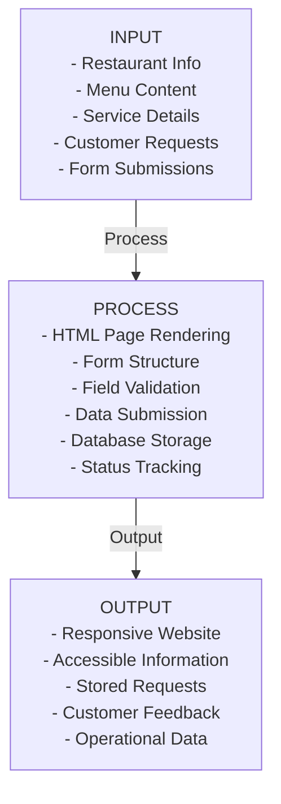

# Valois Grillhouse System Documentation

## Section 1: Background of the Study

**Problem:** Current restaurant information is distributed across multiple static pages; customer requests (reservations, catering, curbside orders) cannot be stored or processed.
**Context:** There is a strong need for centralized information access and robust request management to handle incoming inquiries efficiently and professionally.

## Section 2: Statement of the Problem

**General Problem:**
The Valois Grillhouse website currently presents information but lacks the ability to process and store customer service requests, limiting operational efficiency and customer interaction capability.

**Specific Problems:**
1. Customer reservation requests are received but cannot be stored or tracked
2. Catering inquiries cannot be recorded or followed up on
3. Curbside pickup orders cannot be documented
4. Contact inquiries cannot be persisted for response management
5. No centralized system for managing customer interactions

## Section 3: Objectives of the Study

**General Objective:**
To develop a functional web-based information and request management system for Valois Grillhouse.

**Specific Objectives:**
1. Implement persistent storage for all customer service requests
2. Create a structured database to organize customer interaction data
3. Develop backend API to process form submissions
4. Integrate forms with functional submission handlers
5. Provide validation for data quality and accuracy
6. Ensure user feedback on successful/failed submissions

## Section 4: Proposed System Features

| Feature | Status | Description |
|---------|--------|-------------|
| Contact Form Submission | Implemented | Customers can submit contact inquiries; stored in database |
| Reservation Request Form | Implemented | Customers can request reservations; stored in database |
| Catering Inquiry Form | Implemented | Customers can request catering services; stored in database |
| Curbside Pickup Form | Implemented | Customers can place curbside pickup orders; stored in database |
| Form Validation | Implemented | Client-side and server-side validation of required fields |
| Success Feedback | Implemented | Clear messages to users upon successful submission |
| Error Feedback | Implemented | Clear error messages for invalid input or failed submission |
| Responsive Design | Implemented | Website remains responsive across all devices |
| Data Persistence | Implemented | All submissions stored in SQLite database |
| Information Access | Future Enhancement | Potential for management dashboard to review stored requests |
| Automated Notifications | Future Enhancement | Email confirmations to customers and staff |

## Section 5: Conceptual Framework (IPO Model)

## Section 6: Possible Research Variables

**Independent Variables:**
- User interface clarity (form labeling, instructions)
- Form field organization and layout
- Validation feedback quality (error message clarity)
- Website navigation structure

**Dependent Variables:**
- User satisfaction with form submission process
- Accuracy of submitted data (validation effectiveness)
- Form completion rate (abandonment rate)
- User perception of ease-of-use

## Section 7: Possible Research Questions

1. How effectively does the system capture and store customer service requests?
2. Does form validation improve data quality and reduce submission errors?
3. Is the user feedback (success/error messages) clear and helpful to customers?
4. How well does the responsive design work across different device types?
5. What is the user satisfaction level with the reservation/catering/curbside ordering process?
6. Does the centralized storage of customer requests improve business operations?

## Section 8: Recommended Technology Stack

| Component | Technology | Version | Rationale |
|-----------|-----------|---------|-----------|
| Frontend | HTML5 | HTML5 | Semantic markup, native form support |
| Styling | CSS3 | CSS3 | Responsive design with Grid/Flexbox |
| Client-Side Logic | Vanilla JavaScript | ES6+ | No framework overhead for form handling |
| Backend | Python | 3.8+ | Lightweight, readable, suitable for student projects |
| Web Framework | Flask | 2.3.3 | Minimal, flexible, easy to understand |
| Database | SQLite3 | 3.x | Local, zero-config, appropriate for single-server setup |
| API Communication | RESTful API (JSON) | — | Standard web service pattern |
| Package Manager | pip | — | Python standard for dependency management |
| Version Control | Git | — | Repository already initialized |
| IDE/Editor | VS Code | — | Recommended for team consistency |

## Section 9: Suggested Database Tables

| Table Name | Purpose | Primary Key | Fields |
|-----------|---------|------------|--------|
| **contact_inquiries** | Store customer contact messages | inquiry_id (INT) | inquiry_id, name, email, topic, message, status, created_at |
| **reservations** | Store reservation requests | reservation_id (INT) | reservation_id, customer_name, email, phone, reservation_date, reservation_time, guest_count, occasion, status, created_at |
| **catering_requests** | Store catering event inquiries | catering_id (INT) | catering_id, customer_name, email, event_date, guest_count, event_type, request_details, status, created_at |
| **curbside_orders** | Store curbside pickup orders | order_id (INT) | order_id, customer_name, phone, pickup_time, order_details, status, created_at |
| **menu_items** | Menu structure (future use) | menu_item_id (INT) | menu_item_id, name, category, description, price, image_path, is_available, created_at |

## Alignment Matrix: Problems → Objectives → Questions → Features → Database

| Problem | Objective | Research Question | System Feature | Data Table |
|---------|-----------|-------------------|-----------------|-----------|
| Customer requests cannot be stored | Implement persistent storage | How effectively does the system capture requests? | Contact/Reservation/Catering/Curbside forms | contact_inquiries, reservations, catering_requests, curbside_orders |
| No request tracking capability | Create centralized request management | Does centralized storage improve operations? | Database with request records | All request tables |
| Information scattered across pages | Provide accessible information | Does responsive design work across devices? | Responsive HTML/CSS website | N/A |
| No data quality assurance | Improve data accuracy | Does validation reduce submission errors? | Form validation (client + server) | All request tables (status field) |
| No user feedback on submissions | Provide operational clarity | Is the feedback clear and helpful? | Success/error messages to users | N/A |
